# PJ Motors — Experiência digital e captação de leads

Criei esta experiência para aproximar a apresentação dos veículos elétricos da PJ Motors do atendimento comercial. Reuni uma abertura em vídeo com estética premium, um catálogo interativo, uma simulação em etapas e um painel para acompanhar o caminho do visitante até a intenção de contato pelo WhatsApp.

**[Acessar a demonstração online](https://pj-motors-vercel-corrigido.vercel.app/)** · **Versões para computador e celular**

Trabalhei a proposta visual, a organização do catálogo, os caminhos de atendimento e os conteúdos audiovisuais. Gravei vídeos individuais dos equipamentos para mostrar detalhes que uma ficha técnica ou fotografia isolada não consegue transmitir.

## O problema que procurei resolver

Queria uma experiência que apresentasse os produtos sem transformar a página em uma lista extensa e que encaminhasse o interesse ao atendimento com contexto. O visitante pode chegar querendo conhecer os modelos ou já procurando uma condição de financiamento; organizei o fluxo para atender às duas situações, aproveitando as informações já preenchidas.

## Abertura em vídeo: a identidade vem antes do catálogo

A entrada apresenta a marca sobre um fundo escuro e convida o visitante a conhecer os produtos. Depois do clique inicial, começa uma sequência audiovisual com movimento, enquadramentos dos veículos e acabamento visual premium.

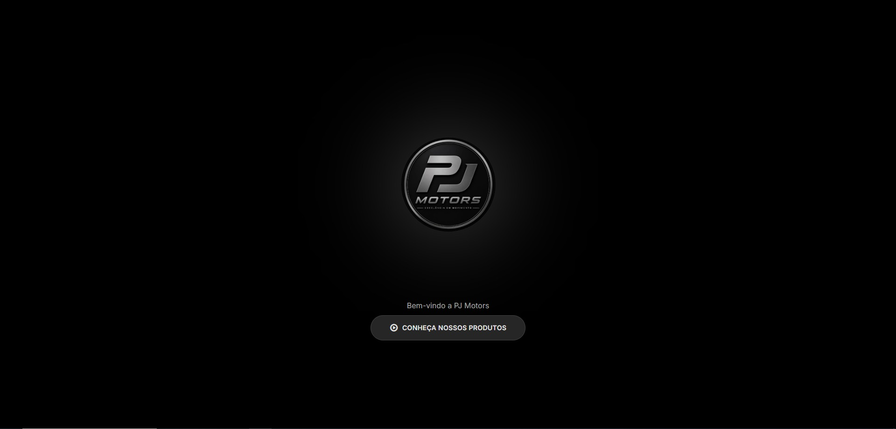

O vídeo faz parte da navegação: ao chegar ao quadro de escolha, a reprodução pausa e áreas clicáveis permitem **Fazer simulação** ou **Ver catálogo**. Preparei a experiência com arquivos de vídeo específicos para computador, tablet e diferentes proporções de celular. As imagens abaixo são quadros dessa abertura em movimento, não telas estáticas independentes.


<details>
<summary>Ver os detalhes e enquadramentos da abertura</summary>


</details>

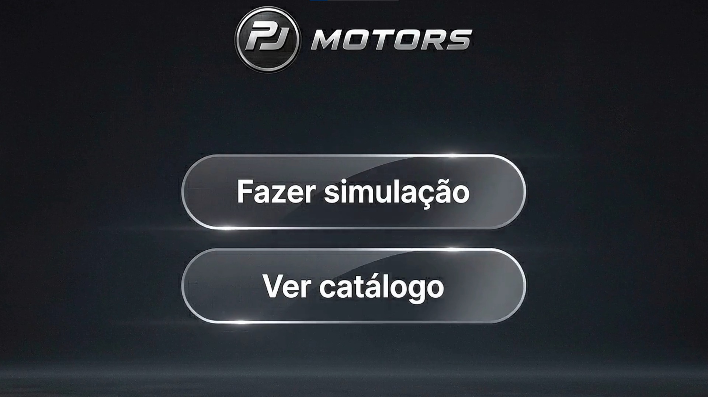

## Dois caminhos, com continuidade até o atendimento

| Caminho | Como organizei a experiência |
| --- | --- |
| **Simular primeiro** | O visitante preenche a simulação, recebe o resultado de triagem e, quando elegível pelas regras do protótipo, usa **Escolher minha moto** para entrar no catálogo. Os dados são reaproveitados: ao selecionar **Comprar Financiado**, ele confirma o pedido com os campos preenchidos e abre o WhatsApp com a mensagem organizada. |
| **Escolher o produto primeiro** | O visitante entra no catálogo e usa **Fazer Financiamento** no modelo desejado. O produto segue identificado para a simulação. Quando conclui com resultado favorável, o botão **Enviar pedido pelo WhatsApp** prepara a mensagem com o modelo e as informações fornecidas, sem exigir nova escolha no catálogo. |

O WhatsApp é aberto com o texto preparado; o envio da mensagem é confirmado pelo próprio visitante no aplicativo. O catálogo também oferece o caminho de compra com opções à vista ou cartão e coleta dos dados necessários ao atendimento.

**Sobre a simulação:** nesta demonstração, o resultado é determinado por regras locais associadas ao perfil selecionado. Não há consulta a banco, birô de crédito ou aprovação financeira real. As expressões de aprovação presentes na interface representam o resultado desse fluxo de demonstração.

## Catálogo dinâmico em duas linhas

Dividi os modelos em **Linha Premium** e **Entrada Acessível**, com navegação independente em cada carrossel. Assim, o visitante percorre os produtos lateralmente sem visualizar todos os cards de uma vez.

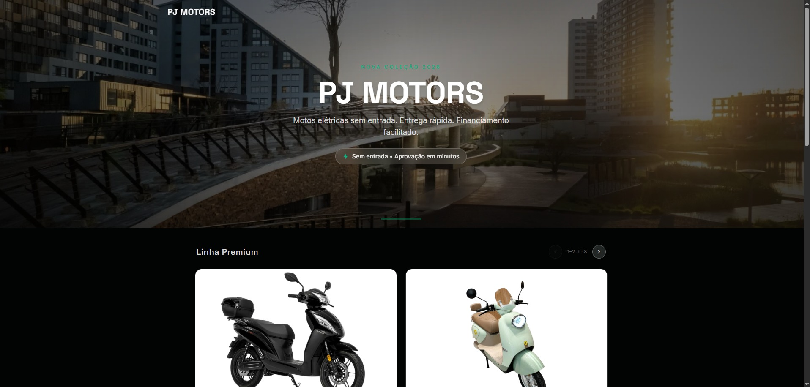

Os cards reúnem imagem do veículo inteiro, potência, velocidade, autonomia, descrição, preço e opções de atendimento. No computador, o carrossel apresenta dois cards; no celular, apresenta um por vez e permite navegação por gesto de arrastar, além dos controles laterais.

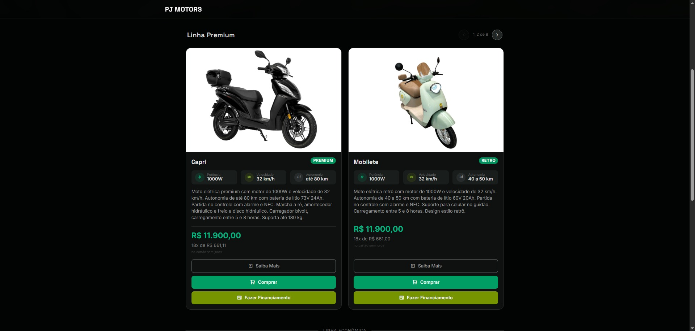

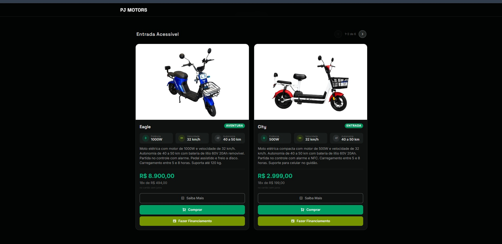

<details>
<summary>Ver os controles de navegação independente das duas linhas</summary>


</details>

## Vídeos próprios para conhecer cada equipamento

No botão **Saiba Mais**, abro o vídeo correspondente ao produto em uma janela sobre o catálogo. Gravei esses conteúdos para apresentar o equipamento de perto, mostrar componentes e explicar detalhes de uso. O visitante pode assistir e voltar ao mesmo contexto de escolha.

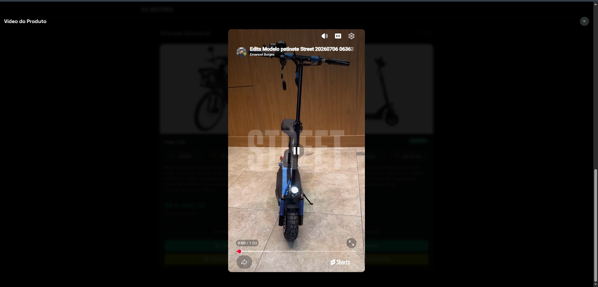

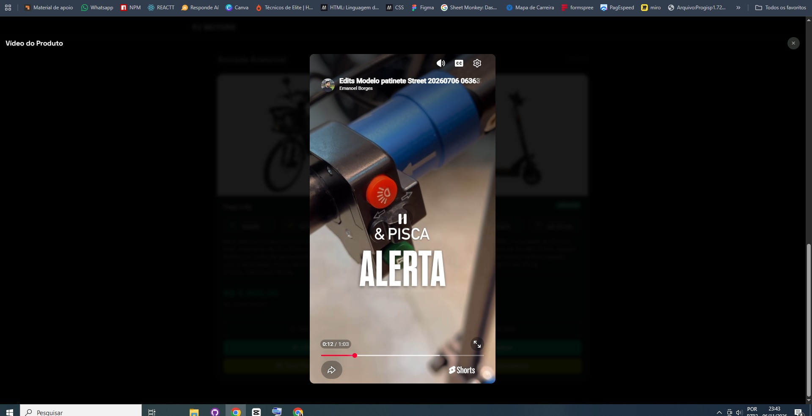

## Simulação em três etapas

Organizei o formulário em **Seus Dados**, **Contato** e **Perfil**. A implementação inclui máscara e validação dos dígitos do CPF, busca de endereço por CEP e validações para avançar entre as etapas. Quando a origem é o catálogo, o modelo escolhido aparece na simulação.

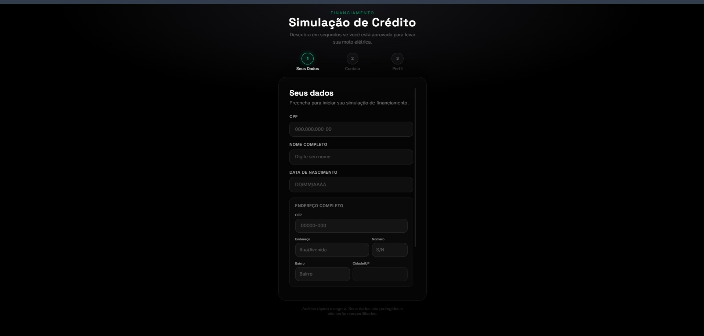

## Painel administrativo em `/admin`

O painel reúne os eventos de navegação registrados no Supabase e os organiza em métricas e leads. Com ele, consigo acompanhar entradas, sessões iniciadas, etapas preenchidas, resultados da simulação e ações de abertura do atendimento.

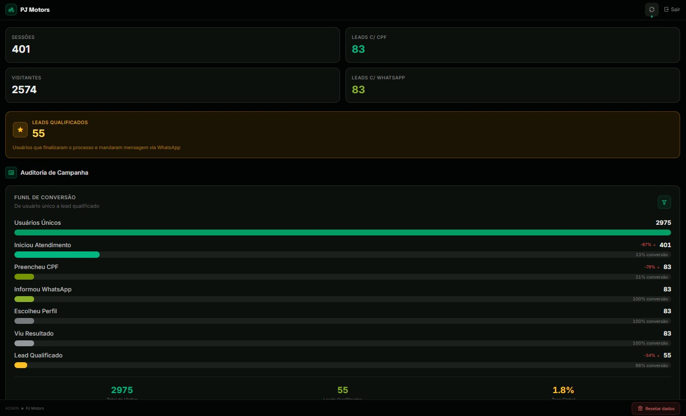

Implementei visualizações para o funil, a distribuição dos perfis, o resumo dos últimos sete dias e uma meta de conversão ajustável. Os filtros por data e a busca por informações do lead ajudam a localizar registros. A agregação também procura consolidar eventos repetidos de uma mesma pessoa.

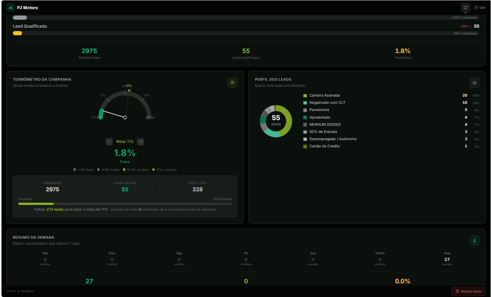

O indicador **lead qualificado** é calculado a partir do evento `compra_enviada`, disparado ao acionar o encaminhamento ao WhatsApp. Ele representa uma intenção registrada no site; não comprova envio efetivo da mensagem, aprovação de crédito ou venda concluída. Os números das capturas são um retrato do painel naquele momento, não uma promessa de resultado.

### Apresentação dos registros com dados pessoais ocultados

Para documentar o painel, substituí a região de dados individuais da captura por marcações opacas. Não incluí a imagem original com nomes, CPFs, telefones, endereços, datas de nascimento ou perfis identificáveis no repositório.

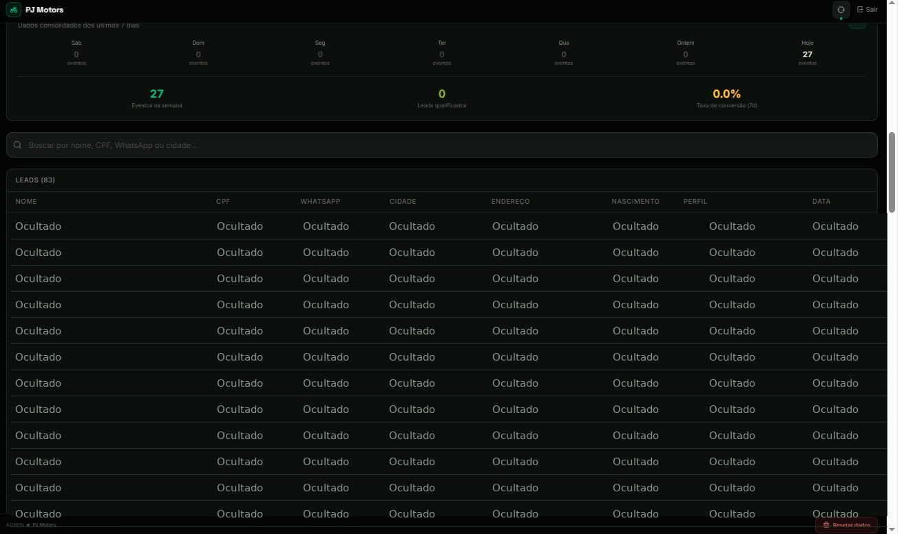

Esse tratamento se refere às imagens da documentação; não é uma declaração de conformidade integral da aplicação com a LGPD. A demonstração utiliza o ambiente de teste existente. O repositório não contém exportações dos registros de clientes.

## Tecnologias e organização

| Recurso | Aplicação no projeto |
| --- | --- |
| React e TypeScript | Componentes, estado e organização das páginas. |
| Vite | Desenvolvimento e compilação da interface. |
| Tailwind CSS | Layout responsivo e identidade visual. |
| React Router | Rotas e continuidade entre catálogo e simulação. |
| Supabase | Autenticação administrativa e armazenamento dos eventos. |
| Recharts | Gráficos e indicadores do painel. |
| YouTube e arquivos MP4 externos | Vídeos individuais e abertura adaptada ao dispositivo. |
| WhatsApp | Mensagem preparada para continuidade do atendimento. |
| Meta Pixel | Eventos de acompanhamento previstos na implementação. |
| Vercel | Hospedagem da demonstração. |

| Pasta | Responsabilidade |
| --- | --- |
| `src/pages/home/` | Entrada, reprodução do vídeo e escolha do caminho. |
| `src/pages/catalogo/` | Carrosséis, cards, vídeos e confirmação do pedido. |
| `src/pages/simulacao/` | Formulário, resultado e encaminhamento. |
| `src/pages/admin/` | Login, métricas, filtros e registros. |
| `src/utils/` | Cliente Supabase, eventos, máscaras e utilitários. |
| `src/mocks/` | Catálogo e regras locais da simulação. |
| `supabase/functions/` | Código da rotina auxiliar de provisionamento. |
| `docs/images/` | Capturas utilizadas nesta apresentação. |

## Executar localmente

Utilize uma versão do Node.js compatível com Vite 8, como Node.js 22.12 ou superior na linha 22, ou uma versão LTS posterior compatível.

```bash
git clone https://github.com/EmanoelAngelo/pj-motors-landing-page.git
cd pj-motors-landing-page
npm ci
```

Copie `.env.example` para `.env` e configure a URL e a chave pública do seu projeto Supabase:

```dotenv
VITE_PUBLIC_SUPABASE_URL=https://SEU_PROJETO.supabase.co
VITE_PUBLIC_SUPABASE_ANON_KEY=SUA_CHAVE_PUBLICA
```

```bash
npm run dev
```

O arquivo `.env`, senhas administrativas, chaves de serviço e dependências instaladas não são versionados. A chave pública do cliente não deve ser substituída por uma chave secreta de serviço.

Para reproduzir o painel em outro ambiente, é necessário configurar a tabela `lead_events`, suas permissões e a autenticação no Supabase. O ZIP original não contém migrações SQL completas; este repositório não provisiona automaticamente uma cópia do banco. A rotina auxiliar `admin-setup` foi preparada para ler `PJ_ADMIN_EMAIL` e `PJ_ADMIN_PASSWORD` do ambiente da função, em vez de expor uma senha fixa. Isso não modifica o ambiente de teste já publicado.

## Compilar e publicar

```bash
npm run build
npm run preview
```

O build gera a pasta **`out`**. O arquivo `vercel.json` define o framework Vite, o comando de compilação, a pasta de saída e o fallback das rotas para `index.html`. Configure as mesmas variáveis públicas do Supabase no ambiente de publicação antes de gerar uma nova versão.

Os vídeos, imagens remotas e integrações dependem dos respectivos serviços externos. A compilação foi validada com Vite 8; a separação manual de chunks do export original foi removida por incompatibilidade com essa versão.

## Aprendizados e evolução

Neste projeto, trabalhei a integração entre conteúdo audiovisual, navegação responsiva e captação de interesse. O ponto central foi dar continuidade ao atendimento nos dois caminhos de entrada, reaproveitando o contexto do produto e os dados já preenchidos.

Como evolução técnica, posso retirar dados pessoais dos parâmetros de URL, revisar a minimização dos dados de rastreamento, reforçar as permissões administrativas e organizar migrações do banco para facilitar a reprodução em novos ambientes.

---

Projeto apresentado por **[Emanoel Angelo](https://github.com/EmanoelAngelo)** para seu portfólio. As marcas e os conteúdos audiovisuais pertencem aos respectivos titulares; a disponibilidade do código não concede licença sobre esses materiais.
